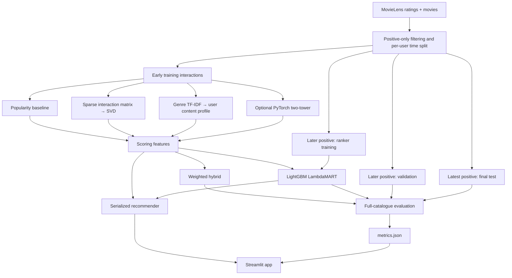

# Reco
An end-to-end AI-powered movie recommendation platform combining collaborative filtering, deep learning, transformer embeddings, and learning-to-rank. Built with Python, PyTorch, LightGBM, and Streamlit, featuring personalized recommendations, model benchmarking, explainability, and reproducible ML pipelines.
# Hybrid Movie Recommender

### Classical machine learning, neural recommendation, and learning-to-rank in one reproducible pipeline

An end-to-end **movie recommendation research project** that compares popularity-based ranking, collaborative filtering, content-based retrieval, a PyTorch two-tower architecture, weighted hybrid scoring, and **LightGBM LambdaMART**.

Built around the **MovieLens latest-small** dataset, the repository demonstrates the full applied machine-learning workflow: data preparation, chronological holdouts, model training, offline evaluation, testing, serialization, and an interactive **Streamlit** demonstration.

> **Project status:** Runnable research / portfolio prototype, designed for noncommercial use. It is **not** a production streaming-service recommendation API. Benchmark results are generated by running the code; none are claimed in advance.

**Tech stack:** Python · NumPy · Pandas · SciPy · scikit-learn · LightGBM · PyTorch (optional) · Sentence Transformers (optional) · Streamlit · pytest · GitHub Actions

---

## Contents

1. [Project goals](#project-goals)
2. [Features and algorithms](#features-and-algorithms)
3. [Architecture](#architecture)
4. [Quick start](#quick-start)
5. [Step-by-step implementation](#step-by-step-implementation)
6. [Dataset and evaluation protocol](#dataset-and-evaluation-protocol)
7. [Model comparison and metrics](#model-comparison-and-metrics)
8. [Interactive application](#interactive-application)
9. [Repository structure](#repository-structure)
10. [Run in a free cloud environment](#run-in-a-free-cloud-environment)
11. [Deploy the demonstration](#deploy-the-demonstration)
12. [Reproducibility, testing, and security](#reproducibility-testing-and-security)
13. [Limitations and future work](#limitations-and-future-work)
14. [Data rights, citation, and license](#data-rights-citation-and-license)

## Project goals

Recommendation systems are more than an algorithm returning similar items. A useful system must address **candidate scoring, personalization, ranking quality, sparse feedback, cold starts, offline measurement, and reproducible deployment**.

This project explores five questions:

- How much do personalized methods improve on a simple popularity baseline?
- How do **latent collaborative representations** compare with movie-genre content profiles?
- Can a **two-tower neural model** add signal beyond classical matrix factorization?
- Does supervised **learning-to-rank** outperform a manually weighted hybrid?
- What can we conclude from **historical ratings**—and what cannot be established without impression logs or online experiments?

The emphasis is on **credible experiments and interpretable engineering trade-offs**, not on maximizing a leaderboard score at any cost.

## Features and algorithms

| Component | Implementation | Purpose |
| --- | --- | --- |
| Popularity | Log-scaled counts of positive training ratings | Non-personalized baseline |
| Collaborative filtering | `TruncatedSVD` applied to a sparse binary user–item matrix | Learn latent user–movie affinities |
| Content-based filtering | TF-IDF encoding of movie genres and per-user genre profiles | Recommend using item metadata |
| Hybrid recommender | Weighted blend of popularity, SVD, genre, and optional neural scores | Combine complementary signals |
| Neural two-tower | PyTorch user-ID embeddings and item-ID + genre features | Learn joint user/item representations |
| Learning-to-rank | LightGBM `LGBMRanker` with a LambdaMART objective | Learn ranking from held-out positives and sampled unobserved items |
| Cold-start recommendations | Selected favorites → genre similarity, item SVD, popularity, optional semantic vectors | Generate suggestions without a known user ID |
| Semantic extension | `all-MiniLM-L6-v2` embeddings of titles and genres | Optional text-based item signal |
| Evaluation | Full-catalogue Recall@K, NDCG@K, catalogue coverage@K | Compare trained methods consistently |
| Web UI | Streamlit | Explore recommendations and benchmark results |

**Important distinctions:**

- The SVD baseline is *truncated matrix decomposition*, not an implicit-ALS objective.
- Sampled unobserved movies are **not confirmed negative preferences**.
- Optional sentence-transformer embeddings represent titles and genres; there is **no LLM chatbot or RAG system** in this repository.
- The demo computes scores against the **small full catalogue**. It does not implement large-scale approximate-nearest-neighbor retrieval.

## Architecture



The deployed app **loads a saved model**, rather than training on every page visit.

## Quick start

**Prerequisite:** Python **3.12 recommended**, an internet connection for the first dataset download, and a terminal. No paid API keys are required.

```bash
# From the repository root:
python -m pip install -r requirements-dev.txt

# Run tests on synthetic data (no MovieLens download needed):
python -m pytest -q

# Download MovieLens and generate exploratory charts:
python -m src.eda

# Train classical models + the LambdaMART ranker:
python -m src.train

# Launch the interactive demo:
streamlit run app.py
```

The Streamlit app runs locally at `http://localhost:8501`. In GitHub Codespaces, use the **Ports** panel to open forwarded port **8501**.

After training, the main outputs are:

```text
data/ml-latest-small/ratings.csv    # Downloaded input, not committed
data/ml-latest-small/movies.csv     # Downloaded input, not committed
reports/eda.png                    # Exploratory plots
artifacts/recommender.joblib        # Trusted serialized recommender
artifacts/metrics.json              # Validation/test measurements
```

`data/` and `artifacts/` are intentionally ignored by Git.

## Step-by-step implementation

### Step 1 — Explore the data

```bash
python -m src.eda
```

`src/eda.py` downloads the public dataset if needed, reports rating counts and catalogue characteristics, displays the train/holdout counts, and saves `reports/eda.png`.

Review the observations before fitting models: user activity is unequal, most movies are rarely rated, and high ratings are not equivalent to observed clicks or impressions.

### Step 2 — Build chronological holdouts

The split is implemented in `src/data.py`, with the default rule **rating ≥ 4.0 = observed positive**. Lower ratings are excluded from this positive-only graph rather than recoded as known negative impressions.

For users with at least **four** positive interactions, the three most recent positive events are reserved:

```text
Past --------------------------------------------------------> Future

[ Earlier positives for fitting ] [ Ranker positive ] [ Validation ] [ Test ]
```

Users with fewer than four positives remain in the fitting data only. Chronological ordering uses `timestamp`, with `movieId` breaking timestamp ties.

The procedure is **per user**, not a global cutoff across all users. The implications are explained under [Limitations and future work](#limitations-and-future-work).

### Step 3 — Fit classical baselines

```bash
python -m src.train --no-ranker
```

This creates four comparable scoring methods:

1. **Popularity:** how often each movie appears in positive *training* feedback.
2. **SVD:** latent user/item representations from a sparse positive-interaction matrix.
3. **Genres:** TF-IDF movie representations scored against a profile derived from each user's training history.
4. **Hybrid:** a fixed blend of popularity, SVD, and genre scores.

The baseline hybrid weights are defined in `src/recommender.py`. They are design choices, **not claims that the weights are optimal**.

### Step 4 — Train LambdaMART

```bash
python -m src.train
```

By default, the same pipeline also trains a LightGBM ranker. Each eligible user's reserved ranker-positive movie is paired with randomly sampled movies that the user has **not been observed to rate positively in training**.

The ranker uses features derived from the early training period:

```text
log_popularity | svd_affinity | genre_affinity | neural_affinity
```

If the two-tower model is not enabled, the neural feature is zero.

**Caveat:** these random alternatives are weak negatives. Some may be relevant movies the user simply never rated; later positives can also remain unobserved during sampling. This is a research approximation, not impression-based counterfactual learning.

### Step 5 — Optionally add a neural two-tower model

Install the optional dependency:

```bash
python -m pip install -r requirements-neural.txt
```

Train all models including the PyTorch model:

```bash
python -m src.train --neural --epochs 4
```

The architecture contains:

- A **user tower** with a learned user-ID embedding.
- An **item tower** combining a learned item-ID embedding and a linear projection of movie genre multi-hot features.
- A **normalized-dot-product similarity** trained with binary cross-entropy on observed positives and sampled unobserved items.

Training uses a GPU if available, otherwise CPU. The trained user/item embedding arrays are stored in the recommender artifact. **PyTorch is not required to serve the exported vectors.**

The `--neural` run **overwrites** `artifacts/recommender.joblib` and `artifacts/metrics.json`. Save earlier measurements separately if you want a before/after comparison.

### Step 6 — Optionally add transformer item embeddings

```bash
python -m pip install -r requirements-optional-nlp.txt
python -m src.semantic
```

This uses `sentence-transformers/all-MiniLM-L6-v2` to encode each movie's **title and genres**. The embeddings are stored in the existing recommender artifact and influence the favorites-based cold-start recommendations.

This step does **not** retrain the known-user ranker or regenerate `metrics.json`. Because titles and genre tags are short, significant improvements are **not guaranteed**.

### Step 7 — Inspect evaluation output

After `python -m src.train`, open `artifacts/metrics.json`, or use the **Benchmark** tab in the app.

Each available model is evaluated against validation and final test events using **full-catalogue scoring** and a consistent exclusion policy. Do not choose hyperparameters based on final test scores.

### Step 8 — Launch and demonstrate

```bash
streamlit run app.py
```

Use the **Known user** tab to compare algorithms on anonymous MovieLens users, or the **Choose favorites** tab to simulate a cold-start visitor.

## Dataset and evaluation protocol

**Dataset:** [MovieLens latest-small](https://grouplens.org/datasets/movielens/latest/), from GroupLens Research, University of Minnesota. It contains movie ratings, titles, genres, timestamps, and anonymized user IDs.

### Train/evaluation separation

| Partition | Role |
| --- | --- |
| Earlier positive interactions | Train SVD, genre user profiles, popularity and optional two-tower |
| Third-to-last positive | Train the LambdaMART ranker |
| Second-to-last positive | Validation and model selection |
| Last positive | Final held-out test |

Previously observed positives are excluded from each user's ranked recommendations. For validation, the ranker-training positive is also excluded; for test, both ranker-training and validation positives are excluded.

**Why chronological evaluation?** A random split can use information from a user's later preferences to predict earlier behavior. This split reduces that form of leakage, but it does **not** fully eliminate global cross-user temporal effects.

### Ranking metrics

Let the top-`K` list be the model's highest-scored eligible movies.

- **Recall@K:** fraction of held-out positive events retrieved in the top `K`. Because there is **one held-out positive per evaluated user**, this is equivalent to Hit Rate@K in this experiment.
- **NDCG@K:** position-sensitive reward for retrieving the held-out positive; higher positions score better.
- **Catalogue coverage@K:** share of catalogue movies that appear in at least one user's top-`K` recommendations.

The default `K` is **10**, configurable with `--k`. Scores are compared on the same validation/test partitions, and the evaluation does **not** use randomly sampled negative candidates.

No benchmark figures are embedded in this README until a real dataset run is performed. **Record the metrics from your own execution**, together with code version and configuration.

## Model comparison and metrics

The final portfolio report should include a table populated from `artifacts/metrics.json`:

| Model | Recall@10 | NDCG@10 | Coverage@10 |
| --- | --- | --- | --- |
| Popularity | Run experiment | Run experiment | Run experiment |
| SVD | Run experiment | Run experiment | Run experiment |
| Genres | Run experiment | Run experiment | Run experiment |
| Weighted hybrid | Run experiment | Run experiment | Run experiment |
| Two-tower (optional) | Run experiment | Run experiment | Run experiment |
| LambdaMART | Run experiment | Run experiment | Run experiment |

**Suggested scientific discussion:** Do personalized methods outperform popularity? Does neural training help at this data scale? Is content helpful for less popular movies? Does the learned ranker improve NDCG but reduce catalogue coverage? Report actual observations, including negative results.

To vary the baseline dimensionality or recommendation list length:

```bash
python -m src.train --rank 32 --k 20
```

To omit the ranker:

```bash
python -m src.train --no-ranker
```

To use custom directories:

```bash
python -m src.train --data-dir data --output-dir artifacts
```

## Interactive application

`app.py` exposes four tabs:

- **Known user** — Select an anonymous MovieLens training user, choose a scoring algorithm, and inspect recommended titles with scores.
- **Choose favorites (cold start)** — Pick favorite movies and receive a hybrid item-similarity ranking without supplying a known user ID.
- **Benchmark** — Explore validation/test values loaded from `metrics.json`.
- **Methodology** — Read the feedback assumptions, data separation, metrics, and known limitations.

**Cold start is deliberately separate:** the selected-favorites experience is based on item metadata and similarity, **not** on claiming that the model has learned a new visitor's user embedding.

The app works with trusted, pre-trained artifacts and does not require GPU hosting.

## Repository structure

```text
hybrid-recommender/
├── README.md
├── START_HERE.md
├── LICENSE
├── .gitignore
├── Dockerfile
├── app.py
├── requirements.txt
├── requirements-dev.txt
├── requirements-neural.txt
├── requirements-optional-nlp.txt
├── src/
│   ├── __init__.py
│   ├── data.py            # Dataset retrieval and chronological split
│   ├── eda.py             # Exploratory statistics and charts
│   ├── recommender.py     # Baselines, hybrid, cold start, ranker
│   ├── neural.py          # Optional PyTorch two-tower
│   ├── semantic.py        # Optional text embeddings
│   ├── evaluation.py      # Full-catalogue ranking metrics
│   └── train.py           # Training CLI and artifact generation
├── notebooks/
│   ├── 01_exploration.ipynb
│   └── 02_results.ipynb
├── reports/
│   └── MODEL_CARD.md
├── tests/
│   └── test_pipeline.py
└── .github/
    └── workflows/
        └── tests.yml
```

`data/` and `artifacts/` appear after the data and training commands run.

## Run in a free cloud environment

**Recommended:** [GitHub Codespaces](https://github.com/features/codespaces) for editing and terminal access; [Google Colab](https://colab.research.google.com/) or [Kaggle Notebooks](https://www.kaggle.com/code) for optional GPU training; [Streamlit Community Cloud](https://share.streamlit.io/) for a public demo. These services have usage limits and may change their free tiers.

A suggested browser-only workflow:

1. Create a GitHub repository and upload the files from this project (preserving the folders).
2. Open **Code → Codespaces → Create codespace**.
3. Run the quick-start commands in the integrated terminal.
4. Optionally train the neural model in a GPU-backed notebook and bring the resulting `artifacts/` files back.
5. Commit source code and documentation; deploy the lightweight app separately.

The latest-small version is intentionally selected so the experiment is practical with modest compute.

## Deploy the demonstration

### Streamlit Community Cloud

1. Train the recommender first with `python -m src.train` or the neural variant.
2. Decide how you will distribute the **trusted generated artifact**, taking into account the MovieLens terms and whether the model may be redistributed.
3. On [Streamlit Community Cloud](https://share.streamlit.io/), select your repository, branch (for example `main`), and entry point **`app.py`**.
4. Deploy with the repository's `requirements.txt`.
5. Visit the public URL and test the four app tabs.

**Note:** `artifacts/` is Git-ignored by default, so a newly deployed app will show a missing-model message **unless the artifact is explicitly made available**. For a small noncommercial demo, you may choose to commit trusted derived artifacts after checking the upstream terms:

```bash
git add -f artifacts/recommender.joblib artifacts/metrics.json
git commit -m "Add trusted demo inference artifacts"
git push
```

Only do so if distributing those artifacts is permitted. Keep raw MovieLens source data out of the repository by default.

### Docker (optional)

After a successful local training run, the included `Dockerfile` can package the app and trusted artifact:

```bash
docker build -t hybrid-movie-recommender .
docker run --rm -p 8501:8501 hybrid-movie-recommender
```

The Docker build expects an existing `artifacts/` directory in the build context. This is an optional deployment path, not required for Codespaces or Streamlit Community Cloud.

## Reproducibility, testing, and security

### Run the test suite

```bash
python -m pytest -q
```

Tests in `tests/test_pipeline.py` use generated synthetic data to check:

- Per-user temporal splitting and train/test separation.
- Exclusion of already-seen items from recommendations.
- Consistent ranking metrics and leakage detection.
- LambdaMART training and serialized prediction equivalence.
- The end-to-end training interface on synthetic input.
- Optional neural model training when PyTorch is available.

The GitHub Actions workflow `.github/workflows/tests.yml` runs the base tests on push and pull requests.

### Reproducibility notes

- The baseline SVD and sampled ranker use fixed random seeds.
- Neural training includes a fixed seed but exact results can still vary by hardware/library version.
- Dependency files specify ranges rather than a completely pinned lockfile.
- The training script overwrites artifacts on repeat runs; version the metrics you wish to compare.
- For serious benchmarking, record dataset version, commit SHA, environment, config, wall-clock time, and resource use.

### Security notes

`joblib` uses pickle-based deserialization: **never load model files from untrusted sources**. Do not accept user-uploaded pickle files in the public app.

The application should not store visitors' selections or personal data by default. Do not commit secrets, 
